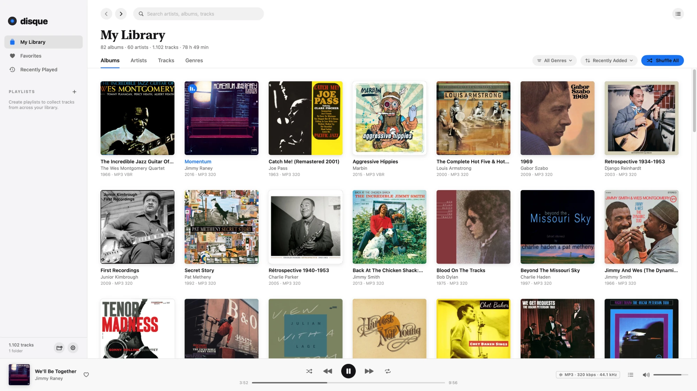
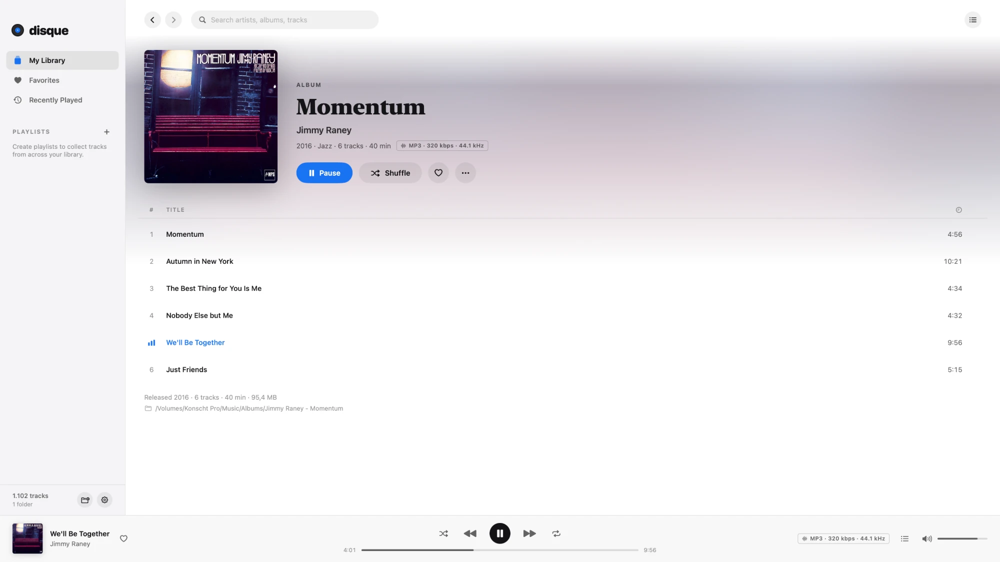
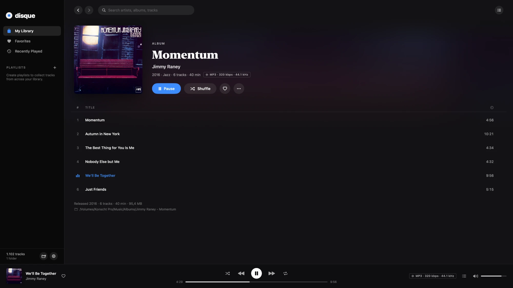

# Disque

A calm, album-first music player for macOS, made for your local music collection. Point it at your music folders and it turns them into a library of covers, artists and genres you can browse. There's no streaming service, no account and nothing to import.

<picture>
  <source media="(prefers-color-scheme: dark)" srcset="docs/screenshots/library-dark.webp">
  
</picture>

## What it does

- **Uses your folders as they are.** Add one or more music folders and Disque picks up everything inside, cover art included. When you add or change files, the library updates by itself.
- **Puts albums first.** Browse by album, artist, track or genre. Album and artist pages sit on a soft, blurred version of the cover art, with "More by…" and "Appears on" sections to keep you exploring.
- **Keeps track of what you like.** Favorite albums, tracks and artists, look back at what you played recently, and make playlists from anything in your library.
- **Finds things fast.** Search covers artists, albums and tracks.
- **Has a proper queue.** Play next, add to queue, drag to reorder, shuffle and repeat. Tracks run into each other with barely a gap, the media keys and Control Center work, and Disque picks up where you left off when you reopen it.
- **Fits in on your Mac.** Light and dark mode follow your system setting, and you can choose the font in Settings.

It's built around MP3, but M4A/AAC, FLAC, WAV and AIFF files play too.

<table>
  <tr>
    <td></td>
    <td></td>
  </tr>
</table>

## Keyboard shortcuts

| Shortcut | Action |
| --- | --- |
| Space | Play / pause |
| ⌘→ / ⌘← | Next / previous track |
| ⌘↑ / ⌘↓ | Volume up / down |
| ⌘F | Search |
| ⌘[ / ⌘] | Back / forward |
| ⌘L | Go to the album that's playing |
| ⌘1 / ⌘2 / ⌘3 | Library / Favorites / Recently Played |
| ⌘O | Add a music folder |
| ⌘R | Rescan the library |
| ⌘N | New playlist |
| ⌥⌘U | Show / hide the queue |

You can also drag a folder onto the window to add it.

## Building it yourself

Disque runs on macOS 15 or later. To build it you need Swift 6, which comes with Xcode or the Command Line Tools.

```bash
scripts/build-app.sh
open build/Disque.app
```

The script puts a ready-to-run `Disque.app` in the `build` folder.

<details>
<summary>Notes for development</summary>

- `swift build` makes a debug build. `.build/debug/Disque --dump-metadata <folder>` prints what Disque reads from your files.
- With only the Command Line Tools installed, the macOS 27 SDK can't build the SwiftUI parts. `scripts/build-app.sh` switches to the newest macOS 26 SDK by itself. For a manual build, set it yourself: `SDKROOT=$(xcode-select -p)/SDKs/MacOSX26.5.sdk swift build`.
- `swift test` runs the tests in `Tests/DisqueTests`. With only the Command Line Tools, also set the SDK as above and point the compiler at the testing macros: `swift test -Xswiftc -plugin-path -Xswiftc $(xcode-select -p)/usr/lib/swift/host/plugins/testing`.
- The app icon comes from `swift scripts/make-icon.swift`.

</details>
